# ♟️ Chess Vision: AI-Powered FEN Generator

A **computer vision** pipeline that converts **chessboard images** into valid **FEN strings** using a **two-stage YOLOv8 pipeline** — deployed as a containerized FastAPI web application.

The system detects the board, classifies all 64 squares, handles **orientation automatically**, and links directly to **Lichess** for instant analysis.


---

## 📋 Table of Contents

1. [Why This Matters](#-why-this-matters)
2. [Model Architecture](#-model-architecture)
3. [Key Features](#-key-features)
4. [How It Works](#-how-it-works)
5. [Evaluation](#evaluation)
6. [Known Limitations](#known-limitations)
7. [Project Structure](#-project-structure)
8. [Tech Stack](#-tech-stack)
9. [Running with Docker](#-running-with-docker) (**Recommended**)
10. [Local Quick Start](#-local-quick-start)
11. [Author](#-author)

---

## 🚀 Why This Matters

Bridging the gap between chess screenshots / video frames and digital engines is a classic computer vision challenge. This project demonstrates an **end-to-end AI pipeline** that solves real-world constraints: **locating the board inside a larger screenshot**, **automatic orientation detection** (White vs. Black at bottom), and **piece recognition across 13 classes**.

Key engineering decisions demonstrated:

- Chaining two **YOLOv8 models** (detection + classification) in a single inference pipeline
- **Bounding-box crop and resize** with OpenCV to normalize the detected board (axis-aligned boards only)
- **FEN compression logic** for engine-readable output
- Containerized deployment via **FastAPI + Uvicorn** inside a Docker container
- **CPU-only inference** — runs without any GPU inside the container
- A **reproducible end-to-end evaluation** on 150 held-out synthetic boards (see [Evaluation](#evaluation))

---

## 🏗️ Model Architecture <a name="-model-architecture"></a>



```mermaid
flowchart LR
    A[Input Image] --> B[YOLOv8 Board Detector]
    B -- Bounding Box --> C[Crop & Resize]
    C --> D[Split into 64 Squares]
    D --> E[YOLOv8 Piece Classifier]
    E -- 13-class Batch Inference --> F[Piece Labels per Square]
    F --> G[Orientation Logic]
    G --> H[FEN String Output]
    H --> I[Lichess Analysis Link]
```

**Stage 1 — Board Detector:** Locates the chessboard in the raw image and returns a bounding box.
**Stage 2 — Piece Classifier:** Receives 64 cropped squares and classifies each (e.g. `WK`, `BP`, `empty`).

---

## 📊 Key Features

| Feature                    | Description                                                                                |
| :------------------------- | :----------------------------------------------------------------------------------------- |
| **2-Stage YOLO Pipeline**  | Decoupling detection from classification improves accuracy on small, densely packed pieces |
| **Smart Orientation** 🧠   | Detects whether the board is flipped (Black at bottom) and adjusts FEN output accordingly  |
| **Web Interface** 🌐       | FastAPI dashboard to upload images and view results instantly in the browser               |
| **Lichess Integration** ♟️ | One-click button opens the scanned position directly in the Lichess Analysis Board         |
| **Docker Deployment** 🐳   | Full containerization — runs the same on any machine with Docker installed                 |
| **CPU Inference** ⚡       | CPU-only PyTorch build skips the multi-GB CUDA packages, keeping the image lean            |
| **Data Tools** 🚜          | Helper scripts to extract piece / empty-square crops and split them for retraining         |
| **Reproducible Evaluation** 📏 | `eval_fen.py` + a seeded 150-board test set report exact-FEN accuracy and latency      |

---

## 🔧 How It Works

### 1. Board Localization

The first YOLO model scans the full input image to detect the chessboard boundaries. The detected box is cropped and resized to a normalized 640×640 square. Perspective correction is **not** implemented, so boards must be roughly front-on, as in screenshots.

### 2. Grid Split

The normalized board is divided into an 8×8 grid. Each of the 64 squares is extracted as an independent image crop.

### 3. Classification & FEN Construction

The second YOLO model classifies each square across 13 classes (`WK`, `WQ`, `WR`, `WB`, `WN`, `WP`, `BK`, `BQ`, `BR`, `BB`, `BN`, `BP`, `empty`).

- Class names are mapped to FEN characters (`WK` → `K`, `BP` → `p`)
- Consecutive empty squares are compressed (`1,1,1` → `3`)
- Row separator `/` is inserted between ranks
- The output is the piece-placement field followed by default fields (`w - - 0 1`); side to move, castling rights and en passant are not detected
- The string is passed to the Lichess editor link as-is (no legality check)

---

## 📏 Evaluation <a name="evaluation"></a>

End-to-end test on **150 unseen synthetic boards**: random legal positions rendered with
[python-chess](https://python-chess.readthedocs.io/), both orientations, 4 square-color themes,
placed at random sizes on plain backgrounds to resemble screenshots. The generator is seeded, so
the set is reproducible. Everything below is the output of `eval_fen.py` (raw numbers in
[`results/eval.json`](results/eval.json)).

| Test set | Boards | Exact-FEN | Per-square | Median latency |
| :-- | :--: | :--: | :--: | :--: |
| 150 synthetic boards | 150 | 99.3% (149/150) | 99.99% | 51 ms (CPU) |

- Board detected: 150/150
- Exact-FEN by orientation: 75/75 Black-at-bottom, 74/75 White-at-bottom
- Exact-FEN by theme: blue 45/45, brown 36/36, gray 37/37, green 31/32
- Latency: median 51 ms, p95 63 ms per board, end-to-end on CPU including image read
- The single miss (`board_138.png`) was a hallucinated white rook on an empty square

### Reproduce

```bash
pip install -r requirements.txt
python eval_fen.py --data fen_testset
```

The test images are committed in `fen_testset/` (with `labels.csv`). To regenerate them:

```bash
pip install -r requirements-eval.txt
python make_testset.py
```

---

## ⚠️ Known Limitations <a name="known-limitations"></a>

- **Clean digital screenshots only.** The detected box is cropped and resized with no perspective
  correction, so photos taken at an angle are not supported.
- **The classifier's own validation score is optimistic.** `util.py` splits individual square
  crops, so crops from the same board can land in both train and val. The evaluation above uses
  newly generated boards instead.
- **Orientation detection handles only a 180° flip** (White at top vs. White at bottom).
- **The synthetic test set uses python-chess's default piece set;** other piece themes and real
  photos are untested.
- **The FEN contains piece placement only.** Side to move, castling rights and en passant are
  fixed defaults (`w - - 0 1`).

---

## 📁 Project Structure

```
chess-vision-fen/
│
├── app/                        # Web application layer
│   ├── static/                 # Logos and generated result images
│   └── apmain.py               # FastAPI backend — routes & inference calls
│
├── models/                     # Trained YOLOv8 weights (tracked in Git)
│   ├── detect/board_train/weights/best.pt            # Stage 1: board detector
│   └── classify/piece_classifier_v1/weights/best.pt  # Stage 2: piece classifier
│
├── templates/                  # Jinja2 HTML templates
│   ├── index.html              # Upload page
│   └── result.html             # FEN result & Lichess link
│
├── fen_testset/                # 150 synthetic test boards + labels.csv
├── results/
│   └── eval.json               # Measured evaluation output
│
├── main.py                     # Core pipeline logic (shared by CLI & FastAPI)
├── eval_fen.py                 # End-to-end exact-FEN evaluation
├── make_testset.py             # Regenerates the synthetic test set (seeded)
├── train_pieces.py             # Training script for the piece classifier
├── util.py                     # Train/val splitter for square crops
├── utilPIECEe.py               # Extract piece crops from annotated data
├── utilEmpty.py                # Extract empty-square crops
├── preprocess_board.py         # Early crop/normalize experiments
│
├── Dockerfile                  # Container build — python:3.11-slim, CPU torch
├── docker-compose.yml          # One-command deployment with healthcheck
├── .dockerignore               # Excludes datasets, cache, and training artifacts
│
├── requirements.txt            # Python dependencies
├── requirements-eval.txt       # Only needed to regenerate the test set
└── README.md
```

---

## 🛠️ Tech Stack <a name="-tech-stack"></a>

| Layer                     | Technology                       |
| :------------------------ | :------------------------------- |
| **Language**              | Python 3.11                      |
| **Object Detection**      | Ultralytics YOLOv8               |
| **Image Processing**      | OpenCV (`opencv-python`)         |
| **Numerics**              | NumPy                            |
| **Web Framework**         | FastAPI                          |
| **ASGI Server**           | Uvicorn                          |
| **Deep Learning Runtime** | PyTorch (CPU build)              |
| **Containerization**      | Docker + Docker Compose          |

---

## 🐳 Running with Docker

The entire application is containerized. **No local Python environment or GPU required.**

### Prerequisites

[Docker Desktop](https://www.docker.com/products/docker-desktop/) installed and running.

### One-Command Start

```bash
git clone https://github.com/Demerdashh/chess-vision-fen.git
cd chess-vision-fen

docker compose up --build
```

Open **http://localhost:8000** in your browser.

> **First build** downloads the CPU PyTorch wheel and the other dependencies, so it takes a few minutes. Subsequent runs use Docker's layer cache and start in seconds.

### Container Details

| Property       | Value                      |
| :------------- | :------------------------- |
| Base image     | `python:3.11-slim`         |
| PyTorch build  | CPU-only — no CUDA drivers |
| Exposed port   | `8000`                     |
| Health check   | `GET /docs` every 30s      |
| Restart policy | `unless-stopped`           |

### Useful Commands

```bash
# Run in background
docker compose up -d

# View live logs
docker compose logs -f

# Stop
docker compose down

# Force rebuild after code changes
docker compose up --build
```

---

## ▶️ Local Quick Start <a name="-local-quick-start"></a>

If you prefer running without Docker:

### 1. Clone & Install

```bash
git clone https://github.com/Demerdashh/chess-vision-fen.git
cd chess-vision-fen
pip install -r requirements.txt
```

### 2. Run the Web App

```bash
uvicorn app.apmain:app --reload
```

Open **http://localhost:8000**.

### 3. Run via CLI

Process a single image without the web server:

```bash
python main.py --input "path/to/your/image.jpg" --visualize
```

---

## 👤 Author

Built by **Youssef El Demerdash**

[](https://www.linkedin.com/in/youssef-eldemerdash-754674378/)
[](https://github.com/Demerdashh)
